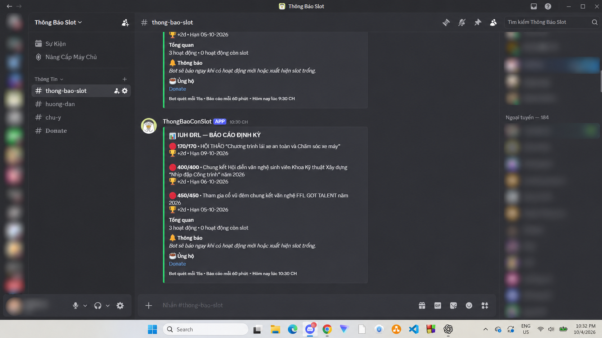
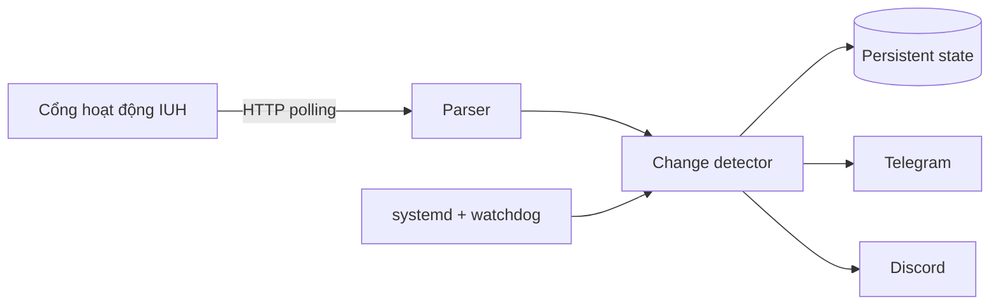

# IUH Activity Monitor

Hệ thống giám sát hoạt động và số lượng đăng ký trên cổng Đoàn Thanh niên IUH, sau đó gửi cảnh báo gần thời gian thực qua Telegram và Discord.

> Dự án cá nhân đang phục vụ một cộng đồng gần 300 thành viên có sử dụng bot trên Discord và Telegram. Dự án cũng đã nhận được sự ủng hộ tự nguyện đầu tiên từ người dùng.

## Bài toán

Các hoạt động có số lượng đăng ký giới hạn có thể mở hoặc hết chỗ nhanh. Việc kiểm tra thủ công liên tục vừa tốn thời gian vừa dễ bỏ lỡ. Dự án tự động hóa chu trình thu thập dữ liệu, phát hiện thay đổi và gửi cảnh báo đến cộng đồng.

## Tính năng

- Theo dõi danh sách hoạt động theo chu kỳ cấu hình được.
- Phát hiện hoạt động còn chỗ và cập nhật khi số chỗ thay đổi.
- Gửi hoặc cập nhật cảnh báo trên Telegram và Discord.
- Lưu trạng thái để hạn chế cảnh báo trùng sau khi khởi động lại.
- Phát hiện phiên đăng nhập hết hạn và báo riêng cho quản trị viên.
- Gửi báo cáo trạng thái định kỳ.
- Chạy 24/7 trên Linux bằng `systemd`, kèm health watchdog.
- Hỗ trợ chạy và kiểm tra kết nối trên Windows.

## Demo thực tế



Ảnh đã được làm mờ tên và avatar thành viên để bảo vệ quyền riêng tư.

Tham gia cộng đồng và xem bot hoạt động: **[Discord — Thông Báo Slot](https://discord.gg/CMAvSEgcjk)**.

## Kiến trúc



Mô hình `nguồn dữ liệu → thu thập → phát hiện thay đổi → cảnh báo → giám sát vận hành` cũng là nền tảng thường gặp trong các hệ thống telemetry và IoT.

## Công nghệ

- Python 3
- Requests, Beautiful Soup
- Telegram Bot API, Discord API
- Linux, systemd, VPS
- JSON state persistence
- GitHub Actions

## Chạy local

### 1. Chuẩn bị môi trường

```bash
python -m venv .venv
```

Kích hoạt môi trường ảo:

```powershell
# Windows PowerShell
.\.venv\Scripts\Activate.ps1
```

```bash
# Linux/macOS
source .venv/bin/activate
```

Cài dependency:

```bash
python -m pip install -r requirements.txt
```

### 2. Cấu hình

Sao chép `.env.example` thành `.env`, sau đó điền các biến cần thiết. Tối thiểu gồm:

```dotenv
TELEGRAM_BOT_TOKEN=
TELEGRAM_CHAT_ID=
PHPSESSID=
```

Không commit `.env`, token bot, cookie phiên đăng nhập hoặc dữ liệu runtime lên GitHub.

### 3. Kiểm tra và chạy

```bash
python test_connection.py
python main.py
```

Chạy unit test:

```bash
python -m unittest discover -v
```

Hướng dẫn thiết lập chi tiết bằng tiếng Việt nằm trong [HUONG_DAN.md](HUONG_DAN.md). Cách triển khai Ubuntu/VPS nằm trong [DEPLOY_VPS.md](DEPLOY_VPS.md).

## Triển khai

Repository có sẵn các service mẫu:

- `iuh-drl-bot.service`: tiến trình giám sát chính.
- `iuh-drl-health.service`: cập nhật trạng thái sức khỏe.
- `iuh-drl-health.timer`: gọi health check định kỳ.

Các file service đang dùng đường dẫn `/opt/iuh-drl-bot`; hãy điều chỉnh nếu triển khai ở vị trí khác.

## Quyền riêng tư và bảo mật

Dự án cần cookie phiên đăng nhập của chính người vận hành để đọc dữ liệu. Cookie này có tính nhạy cảm tương tự thông tin đăng nhập:

- Chỉ lưu trong `.env` trên máy hoặc máy chủ tin cậy.
- Không gửi cookie/token qua tin nhắn hoặc đưa vào ảnh chụp màn hình.
- Thu hồi và tạo lại token ngay nếu nghi ngờ bị lộ.
- Không thu thập hoặc công khai thông tin cá nhân của thành viên.

Xem quy trình báo cáo lỗ hổng tại [SECURITY.md](SECURITY.md).

## Trạng thái dự án

Dự án đang được vận hành và tiếp tục cải tiến dựa trên phản hồi của cộng đồng. Các hướng phát triển dự kiến:

- Bổ sung metric về độ trễ cảnh báo và độ ổn định.
- Mở rộng unit test cho parser và state management.
- Đóng gói bằng Docker.
- Tách adapter nguồn dữ liệu và kênh thông báo.

## Lưu ý

Đây là dự án độc lập, không phải sản phẩm chính thức của Trường Đại học Công nghiệp TP.HCM (IUH). Người vận hành có trách nhiệm tuân thủ quy định của hệ thống nguồn và sử dụng tần suất truy cập hợp lý.

## Tác giả

**Châu Đỗ Hoàng Lương** — [GitHub @luonehaha-hue](https://github.com/luonehaha-hue)
